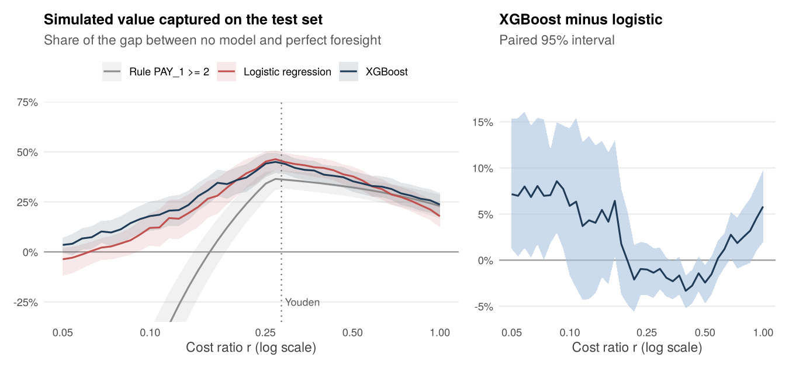

# Credit card default: from probabilities to decisions

Which existing card holders will default next month, and what should the bank
do about it? This project predicts default for 30,000 clients of a Taiwanese
bank (Yeh and Lien, 2009), checks that the predicted probabilities can be
trusted, and turns them into a decision whose threshold comes from the cost of
each kind of error rather than from a classification metric.



*Share of the value of perfect foresight captured on the test set, as a
function of the cost ratio $r$ (what acting on a good client costs relative to
a default). Right: paired difference between XGBoost and the logistic
regression. Details in [part 4](analysis/04_decision.md).*

## Overview

| Part | Question | Main result |
|---|---|---|
| [1. Data and features](analysis/01_data.md) | What do the repayment codes mean, and which statement does a payment settle? | Codes `-2`, `-1`, `0` decoded from the amounts; payments match the previous statement (13.6% exact matches against 2.2% for the same month) |
| [2. Model selection](analysis/02_models.md) | Do the engineered features help, and which model? | Log loss of the logistic regression down by 0.017; XGBoost ahead of the logistic regression by 0.011 |
| [3. Calibration and test set](analysis/03_calibration.md) | Are the probabilities calibrated? What do SMOTE and class weights do? | Calibrated without rebalancing; rebalancing moves every probability up and does not improve the ranking |
| [4. Decisions](analysis/04_decision.md) | Where should the threshold be, and what is each model worth? | Threshold $r/(1+r)$ confirmed on the data; XGBoost adds value only when acting is cheap |
| [5. Robustness](analysis/05_robustness.md) | Do the conclusions survive other splits? | Predictive ranking stable on 10 of 10 splits; one economic result of part 4 does not survive |
| [6. Interpretation](analysis/06_interpretation.md) | What did the models learn, and who do they flag? | Same effects in both models; personal attributes add almost nothing; decisions checked by sex |

## Setup

- **Data.** 30,000 clients, six months of history (April to September 2005):
  repayment status, statement balance and amount paid each month, the credit
  limit, education, marital status and age. 22.1% default in October 2005.
  `SEX` is never a model input.
- **Protocol.** One stratified split into 22,500 training and 7,500 test clients.
  The features were designed after exploring the full data set, test clients
  included. The choice between raw and engineered features, the models, their
  hyperparameters and the treatment of class imbalance were then decided by
  five-fold cross-validation on the training set only. The test set is used
  once. The whole procedure is then repeated on ten further splits.
- **Models.** A constant, the one-split rule `PAY_1 >= 2`, a logistic
  regression with natural splines and an elastic net penalty (glmnet), and
  gradient boosting (XGBoost) tuned by random search with early stopping.
- **Criterion.** Log loss, a proper scoring rule, with the Brier score and the
  AUC alongside. Accuracy, recall and precision depend on a threshold and are
  not used to choose models.

## Results

**Features.** The engineered features are aligned repayment ratios
$P_t / B_{t+1}$, utilisation and its trend, months late, months with a
statement left unpaid, a flag for statements with nothing owed, and implied new
charges $B_t - B_{t+1} + P_t$ from the balance identity. Out of fold on the
training set:

| Model | Log loss | AUC |
|---|---|---|
| Constant | 0.528 | 0.500 |
| Rule `PAY_1 >= 2` | 0.465 | 0.642 |
| Logistic regression, raw columns | 0.451 | 0.758 |
| Logistic regression, engineered features | 0.434 | 0.779 |
| XGBoost, raw columns | 0.425 | 0.785 |
| XGBoost, engineered features | 0.422 | 0.790 |

**Test set** (7,500 clients, scored once): log loss 0.428 and AUC 0.784
[0.771, 0.796] for XGBoost, 0.440 and 0.773 for the logistic regression. Both
are calibrated: the calibration slope of XGBoost is 0.98.

**Class imbalance.** Training with class weights or SMOTE-NC raises the mean
predicted probability from 22% to about 40% and makes the log loss as bad as
the constant's, without improving the AUC. Class weights mostly rescale the
probabilities, and a prior correction undoes most of the damage; SMOTE also
lowers the AUC. Choosing the threshold on calibrated probabilities does the job
directly.

**Decisions.** Keeping a client is worth $r$ per unit of exposure if they repay
and costs 1 if they default; acting is assumed to remove the exposure. The bank
should act when $p > r / (1 + r)$ (Elkan, 2001), the same threshold for every
client. On the
training data the value-maximising thresholds fall within a few points of this.
Youden's threshold, used in the first version of this project, corresponds to
one particular cost ratio, $r = \pi / (1 - \pi) \approx 0.28$, with costs
counted per client rather than per unit of exposure. Over ten splits,
the difference in simulated value captured between XGBoost and the logistic
regression is:

| Cost ratio | XGBoost minus logistic | 95% interval | Splits where XGBoost is ahead |
|---|---|---|---|
| $r < 0.15$ | +5.6 points | [+3.9, +7.4] | 10 of 10 |
| $0.2 < r < 0.6$ | +0.2 points | [-0.5, +0.8] | 6 of 10 |

XGBoost is worth more when acting is cheap. In the middle of the range no
difference could be detected, and the logistic regression is easier to read,
validate and monitor.

**Personal attributes and sex.** Removing education, marital status and age
raises the log loss by about 0.001. At a 20% threshold the models catch the
same share of defaulters among men and women (67%), but good clients are acted
on more often among men (27.7% against 23.3%). The model slightly
underestimates the risk of men. Part 6 discusses what this does and does not
show.

## What did not work as expected

- **Spending as a warning sign.** The hypothesis was that clients who stop
  repaying but keep spending are the riskiest. The opposite holds: the riskiest
  repay little and add nothing to the balance (36.9% default).
- **Codes as numbers.** Treating `PAY_t` as an ordered scale is wrong: clients
  with status `0` default less than those with `-1`.
- **The logistic regression's lead in part 4.** On the main split the logistic
  regression was significantly ahead in the middle cost range. Across ten splits
  the difference vanished.
- **Rebalancing.** Neither SMOTE nor class weights improved anything once the
  threshold was set from costs.

## Limits

- The value of a decision is simulated under a stylised intervention model.
  What a client would have done after a limit cut cannot be observed, and acting
  is assumed to remove the whole exposure.
- The features were designed after looking at all 30,000 clients. Model choices
  were made by cross-validation on the training set only, but the ten splits
  reuse the same clients: this is a check of stability, not a validation on new
  data.
- One bank, one year (2005, a period of heavy card delinquency in Taiwan), and a
  default rate of 22% that is unlikely to describe a portfolio today.

## Repository layout

```
R/
  features.R      status codes, aligned ratios, utilisation, implied charges
  protocol.R      stratified split and folds
  models.R        preprocessing, penalised logistic regression, XGBoost
  metrics.R       log loss, Brier score, AUC
  imbalance.R     SMOTE-NC, prior correction, calibration
  decision.R      cost threshold and policy value
  interpret.R     SHAP values and spline effects
  plotting.R      figure style
scripts/
  get_data.R      download and check the data
  run_cv.R        model selection by cross-validation (part 2)
  run_test.R      imbalance study and test set (part 3)
  run_splits.R    ten further splits (part 5)
  run_ablation.R  models without personal attributes (part 6)
analysis/         one R Markdown file per part, rendered to Markdown
results/          cross-validation and test results, fitted models
tests/            unit tests for the features
```

## Reproducing

Tested with R 4.3.3 and glmnet 4.1.8, xgboost 3.2.1.1, ggplot2 3.4.4,
patchwork 1.2.0, readxl 1.4.3, FNN 1.1.4, rmarkdown 2.25, testthat 3.2.1.

```r
install.packages(c("glmnet", "xgboost", "ggplot2", "patchwork", "scales",
                   "readxl", "FNN", "rmarkdown", "testthat"))
```

From the repository root:

```sh
Rscript scripts/get_data.R            # downloads the data into data/
Rscript -e 'testthat::test_file("tests/test_features.R")'
Rscript scripts/run_cv.R              # a few minutes on two cores
Rscript scripts/run_test.R
Rscript scripts/run_splits.R          # about 30 minutes
Rscript scripts/run_ablation.R
cd analysis && Rscript -e 'for (f in list.files(pattern = "Rmd$")) rmarkdown::render(f)'
```

The results of every script are already in `results/`, so the analysis files
can be rendered without running the scripts.

## Context

The first version of this project was a course project at Sorbonne University:
descriptive analysis, clustering and a comparison of classifiers chosen on
balanced accuracy after SMOTE. This version rebuilds it around the quality of
the probabilities and the decision they support.

## References

- Yeh, I.-C. and Lien, C. (2009). The comparisons of data mining techniques for
  the predictive accuracy of probability of default of credit card clients.
  *Expert Systems with Applications*, 36(2), 2473–2480.
- Yeh, I.-C. (2016). Default of credit card clients [Dataset]. UCI Machine
  Learning Repository. https://doi.org/10.24432/C55S3H
- Chawla, N. V., Bowyer, K. W., Hall, L. O. and Kegelmeyer, W. P. (2002). SMOTE:
  Synthetic minority over-sampling technique. *Journal of Artificial
  Intelligence Research*, 16, 321–357.
- Elkan, C. (2001). The foundations of cost-sensitive learning. *IJCAI*.
- Nadeau, C. and Bengio, Y. (2003). Inference for the generalization error.
  *Machine Learning*, 52, 239–281.
- Lundberg, S. M. and Lee, S.-I. (2017). A unified approach to interpreting
  model predictions. *NeurIPS*.
- Chouldechova, A. (2017). Fair prediction with disparate impact. *Big Data*,
  5(2), 153–163.
- Kleinberg, J., Mullainathan, S. and Raghavan, M. (2017). Inherent trade-offs in
  the fair determination of risk scores. *ITCS*.

## License

MIT. The data set is distributed by the UCI Machine Learning Repository under
CC BY 4.0.
