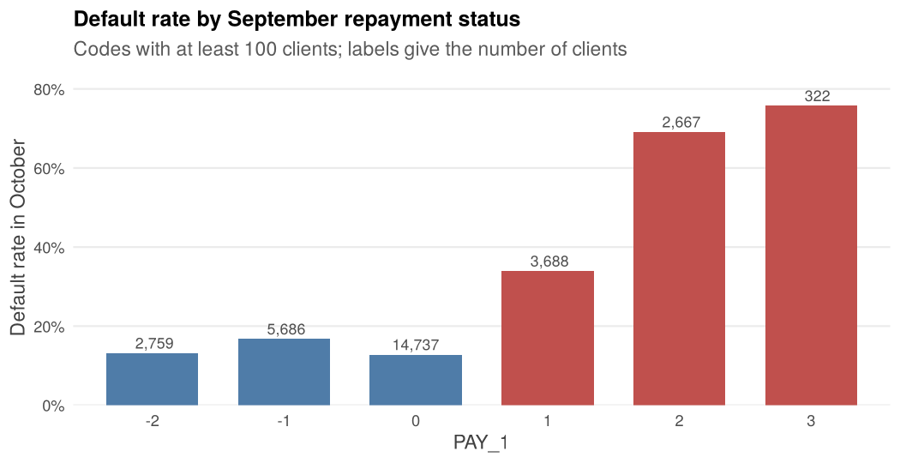

1. Data and features
================

The data are the 30,000 credit card holders of a Taiwanese bank studied
by Yeh and Lien (2009). For each client we observe the credit limit, a
few demographic variables and six months of history, April to September
2005: the repayment status `PAY_t`, the statement balance `BILL_AMT_t`
and the amount paid `PAY_AMT_t`. The target is whether the client
defaults in October 2005; 22.1% do.

Month `t = 1` is September and `t = 6` is April. The source file calls
the September status `PAY_0` and has no `PAY_1`; it is renamed `PAY_1`
here so that the three monthly series share the same index.

`SEX` is dropped from every model. A credit decision may not depend on
it, and leaving it out of the inputs is the minimum; the decision rule
is checked for differences between groups at the end of the project.

## Repayment status codes

The documentation describes `PAY_t = -1` as “paid duly” and `PAY_t = k`
for `k = 1, ..., 9` as a payment delay of `k` months. The values `-2`
and `0`, which make up most of the data, are not documented. The amounts
tell what they mean. For every status, the table gives the share of
client-months in which the previous statement was paid in full and the
share in which the current balance is zero or negative.

| status | client-months | previous statement paid in full | balance zero or negative |
|:-------|--------------:|--------------------------------:|-------------------------:|
| -2     |        16,761 |                           95.3% |                    63.4% |
| -1     |        23,214 |                           75.8% |                    10.5% |
| 0      |        64,896 |                            5.1% |                     2.0% |
| 1 to 8 |        15,129 |                            6.5% |                     2.4% |

`-1` is a client who clears the statement, as documented. `-2` is a
client with nothing to pay, either no balance or a balance already
settled. `0` is a client who uses the revolving credit: the statement is
not cleared, but the client is not reported late. The codes are
therefore not an ordered scale, and the default rate confirms it:
revolving clients (`0`) default less often than clients who pay in full
(`-1`).

<!-- -->

The code `1` also behaves differently from one month to the next. It is
frequent in September and almost absent before:

|   Sep | Aug | Jul | Jun | May | Apr |
|------:|----:|----:|----:|----:|----:|
| 3,688 |  28 |   4 |   2 |   0 |   0 |

In the earlier months a client one month late seems to be recorded as
`2` or not at all. The features below therefore use the number of months
late and whether a client is late at all, rather than the exact code.

## Which statement does a payment settle?

Since `t` counts backwards, the statement of the previous month is
`BILL_AMT_{t+1}`. A payment made in month `t` should settle that
statement, not the one issued at the end of month `t`. The data agree:
the amount paid matches the previous statement exactly far more often
than it matches the current one.

| month | equals previous statement | equals same-month statement |
|:------|--------------------------:|----------------------------:|
| Sep   |                     13.6% |                        2.2% |
| Aug   |                     13.6% |                        2.1% |
| Jul   |                     13.6% |                        2.1% |
| Jun   |                     14.5% |                        2.2% |
| May   |                     15.4% |                        1.9% |

Ratios of payment to balance taken within the same month mix two
different statements. All ratios below are aligned.

## Features

Writing $B_t$ for the statement balance, $P_t$ for the amount paid and
$L$ for the credit limit:

| Feature                                     | Definition                                                                                                                                              |
|---------------------------------------------|---------------------------------------------------------------------------------------------------------------------------------------------------------|
| `status_1`, `delay_1`                       | September status (no balance, paid in full, revolving, late) and months late                                                                            |
| `max_delay`, `months_late`                  | worst delay and number of months late over the six months                                                                                               |
| `months_full`, `months_revolv`              | number of months with status `-1` and `0`                                                                                                               |
| `worsening`                                 | September delay larger than August delay                                                                                                                |
| `util_1`, `util_mean`, `util_slope`         | utilisation $u_t = B_t / L$: last value, mean and least-squares trend                                                                                   |
| `repay_1`, `repay_mean`                     | repayment ratio $r_t = \min(P_t / B_{t+1}, 1)$, set to 1 when $B_{t+1} \le 0$                                                                           |
| `nothing_owed_1`, `months_nothing_owed`     | $B_{t+1} \le 0$ in September, and the number of such months; separates a client with nothing to pay from one who paid in full, which $r_t$ alone cannot |
| `months_no_pay`                             | months with $B_{t+1} > 0$ and $P_t = 0$                                                                                                                 |
| `spend_1`, `spend_mean`                     | implied new charges $(B_t - B_{t+1} + P_t) / L$: purchases plus interest and fees                                                                       |
| `log_limit`, `age`, `education`, `marriage` | as given; undocumented education and marriage codes grouped as `other`                                                                                  |

The charges feature comes from the balance identity
$B_t = B_{t+1} - P_t + \text{purchases}_t + \text{interest and fees}_t$.
Purchases and interest cannot be told apart in the data, so the feature
measures both. It is still the only feature that reacts to what is added
to the balance rather than to what is paid off.

How well does each feature rank clients on its own? The table gives the
AUC of each numeric feature used as a score, oriented so that it is
above one half. This is a description of the full data set, not an
out-of-sample result: no model is fitted, but the same clients will
later be split into training and test sets. Out-of-sample performance is
measured in the next part.

| feature                       |   AUC |
|:------------------------------|------:|
| months_late                   | 0.726 |
| max_delay                     | 0.716 |
| delay_1                       | 0.699 |
| PAY_1 as a number             | 0.690 |
| months_no_pay                 | 0.647 |
| log_limit                     | 0.618 |
| months_revolv                 | 0.610 |
| repay_1                       | 0.589 |
| repay_mean                    | 0.587 |
| worsening                     | 0.567 |
| repay_1, same-month statement | 0.564 |
| util_mean                     | 0.564 |
| spend_mean                    | 0.558 |
| spend_1                       | 0.556 |
| util_slope                    | 0.554 |
| months_full                   | 0.553 |
| util_1                        | 0.551 |
| months_nothing_owed           | 0.505 |
| nothing_owed_1                | 0.504 |
| age                           | 0.504 |

The delinquency history dominates, as expected. Counting the months late
(0.726) ranks clients better than the raw September code (0.690).
Aligning the repayment ratio with the right statement raises its AUC
from 0.564 to 0.589.

The `nothing_owed` flags rank clients no better than chance on their
own, but they matter next to the repayment ratio. Among the clients with
$r_1 = 1$, those who had nothing to pay default more often than those
who paid the statement in full:

|                        | clients | default rate |
|:-----------------------|--------:|-------------:|
| statement paid in full |   6,823 |        13.9% |
| nothing owed           |   3,175 |        23.4% |

## Spending while not repaying

The expectation was that clients who stop repaying but keep spending,
living on the card, would be the riskiest. The data say otherwise. The
two cut-offs below (10% repaid, new charges above 2% of the limit) were
chosen by hand for this table and are not used anywhere else.

|                                 | no new spending | keeps spending |
|:--------------------------------|----------------:|---------------:|
| repays less than 10% on average |           36.9% |          24.1% |
| repays more                     |           21.8% |          14.1% |

The riskiest group repays little and adds little to the balance. These
clients were late in 2.2 of the six months on average, against 1.0 for
those who still spend. One possible explanation, which the data cannot
confirm, is that the bank restricts the card once a client falls behind;
low spending would then follow from delinquency rather than predict
default on its own. The feature is kept for prediction, but it is not
read causally.

## Inputs to the models

Two input sets are compared in the next part.

- **Raw**: the 22 original columns except `SEX`, with the `PAY_t` codes
  as numbers. This is what most analyses of this data set use.
- **Engineered**: the features above.

The features were designed after looking at all 30,000 clients, test
clients included. To keep this from biasing the results, the choice
between the two sets, like every other modelling choice, is made by
cross-validation on the training set only, and the test set is used once
at the end. If the engineered set does not improve the cross-validated
log loss, it is not used.
