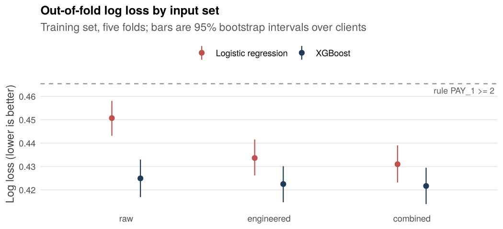

2. Protocol and model selection
================

The numbers on this page come from `scripts/run_cv.R`, which writes
`results/cv.rds`.

## Protocol

The clients are split once into a training set (22,500 clients) and a
test set (7,500), stratified on the target. The test set is not used on
this page. The training set is divided into five stratified folds, and
every choice below (input set, model, hyperparameters) is made on
out-of-fold predictions: each client is scored by a model that did not
see them.

Models are compared on the **log loss** of their predicted
probabilities,

$$
\ell = -\frac{1}{n} \sum_{i=1}^n \big[ y_i \log p_i + (1 - y_i) \log(1 - p_i) \big].
$$

Accuracy, recall and precision all depend on a decision threshold, and
the right threshold depends on what a default costs the bank, which is
the subject of part 4. The log loss is a proper scoring rule: it is
minimised in expectation by the true probabilities, so a model that wins
on it is the one whose probabilities can be trusted to set that
threshold. The Brier score $\frac1n \sum (p_i - y_i)^2$ is another
proper score and is reported alongside. The AUC only measures how well
clients are ranked and says nothing about whether a predicted 20% means
20%.

## Models

- **Constant**: the training default rate for everyone. Its log loss,
  the entropy of the target, is the reference every model has to beat.
- **Rule**: the single split `PAY_1 >= 2` (two months late in
  September), turned into a probability by using the default rate of
  each group. It is the first split a classification tree makes on this
  data, and a rule a credit officer could apply by hand.
- **Logistic regression** with an elastic net penalty. Continuous inputs
  are winsorised and expanded in natural cubic splines with four degrees
  of freedom, so the model is additive but not linear. The mixing weight
  $\alpha \in \{0, 0.5, 1\}$ and the penalty $\lambda$ are tuned.
- **Gradient boosting** (XGBoost) with learning rate 0.03. Thirty random
  configurations of depth, minimum child weight, row and column
  subsampling, L2 penalty and minimum split loss are tried, the number
  of trees being set by early stopping on the mean validation loss.

Each model is fitted on three input sets: the **raw** columns, the
**engineered** features of part 1, and both **combined**.

## Results

| model                | log loss | pseudo R2 |  Brier |   AUC |
|:---------------------|---------:|----------:|-------:|------:|
| Constant             |   0.5284 |     0.000 | 0.1723 | 0.500 |
| Rule PAY_1 \>= 2     |   0.4654 |     0.119 | 0.1455 | 0.642 |
| Logistic, raw        |   0.4507 |     0.147 | 0.1414 | 0.758 |
| Logistic, engineered |   0.4336 |     0.179 | 0.1358 | 0.779 |
| Logistic, combined   |   0.4310 |     0.184 | 0.1351 | 0.781 |
| XGBoost, raw         |   0.4249 |     0.196 | 0.1331 | 0.785 |
| XGBoost, engineered  |   0.4225 |     0.201 | 0.1323 | 0.790 |
| XGBoost, combined    |   0.4216 |     0.202 | 0.1321 | 0.791 |

The pseudo $R^2$ is McFadden’s, $1 - \ell / \ell_0$, with $\ell_0$ the
log loss of the constant.

<!-- -->

Differences between two models are measured on the same clients, so they
are much more precise than the intervals above suggest. The table gives
the mean difference in log loss and a 95% interval from a paired
bootstrap over clients.

| comparison                                  | difference |         95% interval |
|:--------------------------------------------|-----------:|---------------------:|
| Logistic, engineered vs Logistic, raw       |    -0.0171 | \[-0.0200, -0.0141\] |
| Logistic, combined vs Logistic, engineered  |    -0.0027 | \[-0.0040, -0.0013\] |
| XGBoost, engineered vs XGBoost, raw         |    -0.0024 | \[-0.0042, -0.0007\] |
| XGBoost, combined vs XGBoost, engineered    |    -0.0008 | \[-0.0020, +0.0003\] |
| XGBoost, engineered vs Logistic, engineered |    -0.0112 | \[-0.0137, -0.0089\] |
| Logistic, raw vs Rule PAY_1 \>= 2           |    -0.0147 | \[-0.0193, -0.0099\] |

**Feature engineering.** For the logistic regression the engineered
features are the largest gain on this page: the log loss drops by
0.0171, two thirds of the gap between the logistic regression and
boosting on the raw columns. Boosting gains much less, 0.0024, but the
interval excludes zero. Trees presumably find most of what the features
encode by themselves, except the ratios and the alignment of payments
with statements, which they cannot build from single splits. Adding the
raw columns back helps the logistic regression a little more and does
not help boosting significantly.

**The rule is a hard benchmark.** The one-split rule reaches a pseudo
$R^2$ of 0.119, against 0.147 for the logistic regression on the raw
columns, which is the model most analyses of this data set report. A
model has to earn its complexity against `PAY_1 >= 2`, not against a
constant.

**Choice of models.** Two models are carried forward:

- **XGBoost on the engineered features**, the main model. The combined
  set is not significantly better and has twice as many columns.
- **Logistic regression on the engineered features**, the interpretable
  reference. It is behind boosting by 0.0112; part 4 checks whether that
  gap is worth anything once it is converted into money.

The selected boosting configuration has depth 6, minimum child weight
7.6, row and column subsampling 0.65 and 0.55, L2 penalty 5.23, minimum
split loss 0.02 and 198 trees. The logistic regression uses $\alpha = 1$
(lasso) and $\lambda = 2.4\times 10^{-4}$.

## Caveats

- The hyperparameters were chosen on the same folds that produce these
  scores, so the scores are slightly optimistic, for the selected
  boosting model more than for the others since it was picked among
  thirty. The test set gives the unbiased figure in part 3.
- The bootstrap intervals resample clients but not training sets, so
  they ignore the variability that comes from refitting the models. Part
  5 repeats the whole procedure over several splits.
