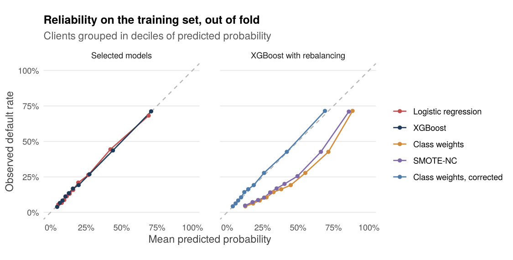

3. Calibration, class imbalance and test set
================

The numbers on this page come from `scripts/run_test.R`.

## Are the probabilities calibrated?

A model is calibrated if, among the clients it gives a probability $p$,
a share $p$ default. Part 4 turns probabilities into decisions by
comparing them with a cost ratio, so this matters more here than the
ranking. Two checks are used: a reliability diagram, which bins clients
by predicted probability, and the calibration intercept and slope,
obtained by regressing the outcome on the predicted log-odds,

$$
\operatorname{logit} \mathbb{P}(Y = 1 \mid p) = a + b \operatorname{logit}(p).
$$

A calibrated model has $a = 0$ and $b = 1$. A slope below one means the
predictions are too extreme, above one too timid.

| model               | mean prediction | default rate | intercept | slope |
|:--------------------|----------------:|-------------:|----------:|------:|
| Logistic regression |           22.1% |        22.1% |    -0.000 | 0.991 |
| XGBoost             |           22.1% |        22.1% |    +0.004 | 1.000 |

Both models, fitted without any reweighting, are calibrated out of fold.
No recalibration step (Platt scaling, isotonic regression) is needed,
and adding one would only spend data.

## Rebalancing the classes

22.1% of the clients default. A common reaction is to rebalance the
training data, either by weighting the defaults by
$w = n_0 / n_1 = 3.52$ or by creating synthetic defaults with SMOTE
until the two classes are the same size. Both were tried on the selected
XGBoost configuration, inside the cross-validation folds so that
synthetic clients never reach a validation fold. SMOTE is used in its
SMOTE-NC form: continuous features are interpolated between neighbours,
while counts, flags and months of delay are copied from one of the two
clients, since a client cannot be 2.4 months late.

| training       | mean prediction | log loss |   AUC | calibration intercept | log loss after correction |
|:---------------|----------------:|---------:|------:|----------------------:|--------------------------:|
| No rebalancing |           22.1% |   0.4223 | 0.790 |                 +0.00 |                           |
| Class weights  |           41.3% |   0.5287 | 0.790 |                 -1.18 |                    0.4228 |
| SMOTE-NC       |           38.6% |   0.5065 | 0.782 |                 -1.01 |                    0.4320 |

Rebalancing does not help the model tell good and bad clients apart:
class weights leave the AUC unchanged and SMOTE lowers it. What it does
is move every probability up. With class weights the mean prediction is
41.3% for a default rate of 22.1%, and the log loss is as bad as that of
the constant model (0.5284).

The shift is predictable. Weighting the defaults by $w$ multiplies the
odds the model estimates by $w$, so the original probabilities are
recovered by

$$
\tilde p = \frac{p}{p + w (1 - p)}.
$$

After this correction the weighted model is as good as the unweighted
one: the whole effect of the weights was a change of scale. The same
correction does not fully repair SMOTE, whose synthetic clients are not
draws from the population of defaulters, and SMOTE stays worse on every
measure.

<!-- -->

The practical consequence is that rebalancing and the choice of a
decision threshold do the same job. A model trained with weights $w$ and
cut at 0.5 flags, up to estimation noise, the same clients as the
unweighted model cut at $1 / (1 + w)$. Doing both, as in the original
version of this project (SMOTE, then a threshold tuned on balanced
accuracy), corrects for the imbalance twice. The models below are
trained on the data as it is, and the threshold is set in part 4 from
the costs.

## Test set

The two selected models were refitted on the whole training set with the
hyperparameters chosen in part 2 and scored once on the 7,500 test
clients. Nothing on the previous pages was changed after this.

| model               | log loss |     95% interval |  Brier |   AUC | AUC 95% interval |
|:--------------------|---------:|-----------------:|-------:|------:|-----------------:|
| Constant            |   0.5284 | \[0.517, 0.540\] | 0.1723 | 0.500 |                  |
| Rule PAY_1 \>= 2    |   0.4706 | \[0.458, 0.484\] | 0.1477 | 0.638 | \[0.627, 0.649\] |
| Logistic regression |   0.4396 | \[0.426, 0.453\] | 0.1385 | 0.773 | \[0.761, 0.786\] |
| XGBoost             |   0.4281 | \[0.415, 0.441\] | 0.1348 | 0.784 | \[0.771, 0.796\] |

The ranking of part 2 holds on new clients. XGBoost beats the logistic
regression by 0.0115 in log loss (paired 95% interval \[0.0077,
0.0157\]) and the rule by 0.0425 (\[0.0360, 0.0493\]). Its test log loss
is 0.4281, against 0.4225 out of fold: the gap is the optimism left by
tuning on the training folds, plus sampling noise, and it is small.

Calibration also carries over. On the test set the calibration slope is
0.981 for XGBoost and 0.961 for the logistic regression, with intercepts
of +0.020 and +0.018.

For comparison, the original version of this project reported an AUC of
0.772 for XGBoost, on a single split with no tuning and different
features. The difference with the AUC above is within the sampling noise
of a 7,500-client test set, which is why the comparisons on this page
are paired and why part 5 repeats the procedure over several splits.
