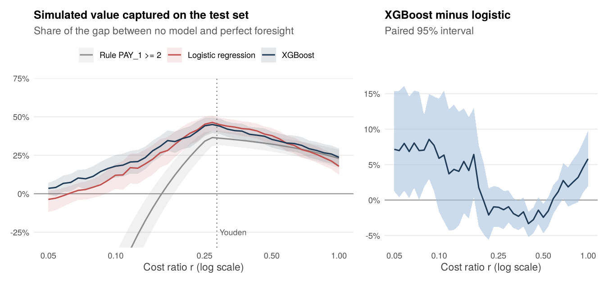

4. From probabilities to decisions
================

A score is only useful once it changes what the bank does. This page
sets the decision rule from the costs, checks it against the data, and
compares the models by the economic value they would produce under a
stylised model of the bank’s intervention. The value is simulated, not
observed: the data record what happened without intervention, and what a
client would have done after a limit cut or a frozen card cannot be
seen.

## Decision rule

In September the bank can either keep an account as it is or act on it:
cut the limit, freeze the card, start collection early. In this stylised
model, acting is assumed to remove the exposure, so it neither earns nor
loses anything. This is optimistic: freezing a card stops new spending
but does not erase the balance already owed. Keeping the account earns a
margin if the client repays and loses the defaulted amount otherwise.
Per unit of exposure, with the loss given default as the unit of cost:

|      | client repays | client defaults |
|------|---------------|-----------------|
| keep | $+r$          | $-1$            |
| act  | $0$           | $0$             |

The cost ratio $r$ is what the bank gives up by acting on a good client,
relative to what a default costs. A client with default probability $p$
is worth $(1 - p)\,r - p$ per unit of exposure if kept, so the bank
should act when

$$
p > t(r) = \frac{r}{1 + r}.
$$

The exposure cancels out: the threshold is the same for every client,
and only the probability matters. This is where calibration enters. A
model whose 20% does not mean 20% would apply the wrong threshold,
however well it ranks clients.

The exposure is the September balance, set to zero when it is negative.
The model is deliberately simple: acting rarely removes the whole
exposure, and a good client who is acted on may be lost for longer than
a month. Both effects change $r$ rather than the form of the rule, so
results are given over a range of $r$ instead of for a single guess.

Three values of $r$ are used as reference points:

| $r$  | threshold | reading                                                   |
|------|-----------|-----------------------------------------------------------|
| 0.10 | 9.1%      | a default costs ten times as much as losing a good client |
| 0.25 | 20.0%     | four times as much                                        |
| 0.50 | 33.3%     | twice as much                                             |

## Does the theory hold on the data?

If the probabilities are calibrated, the threshold that maximises the
value on past data should be close to $t(r)$. The table compares the two
on the training set, out of fold, searching thresholds on a grid of step
0.005.

| cost ratio r |  t(r) | best threshold, logistic | best threshold, XGBoost |
|-------------:|------:|-------------------------:|------------------------:|
|         0.10 | 0.091 |                    0.085 |                   0.095 |
|         0.25 | 0.200 |                    0.215 |                   0.210 |
|         0.50 | 0.333 |                    0.320 |                   0.295 |

The best thresholds found on the data are within a few points of the
theoretical ones, and none is systematically above or below. The
thresholds below are therefore set from $r$ alone, and nothing is tuned
on the test set.

The balanced accuracy and Youden’s index used in the original version of
this project are a special case. Maximising balanced accuracy gives a
missed default a weight $1/n_1$ and a false alarm a weight $1/n_0$,
which is the cost ratio $r = n_1 / n_0 = 0.284$ and, for a calibrated
model, the threshold $t = \pi = 0.221$, the default rate. Youden’s
threshold is not neutral: it fixes the costs implicitly, and they are
counted per client rather than per unit of exposure.

## Simulated value on the test set

Each policy is scored by its simulated value relative to two references.
The floor is the better of the two policies that need no model, keeping
everyone or acting on everyone, since a model has to beat both. The
ceiling is perfect foresight: acting on exactly the clients who will
default. The share of the distance between floor and ceiling that a
policy covers is reported, with a 95% bootstrap interval over test
clients.

|    r | policy              | clients acted on | precision | recall | value captured |       95% interval |
|-----:|:--------------------|-----------------:|----------:|-------:|---------------:|-------------------:|
| 0.10 | Rule PAY_1 \>= 2    |            10.2% |     68.6% |  31.6% |         -57.8% | \[-77.6%, -39.1%\] |
| 0.10 | Logistic regression |            78.1% |     26.6% |  93.9% |          12.1% |    \[3.2%, 19.3%\] |
| 0.10 | XGBoost             |            71.5% |     28.6% |  92.3% |          16.9% |    \[9.5%, 24.0%\] |
| 0.25 | Rule PAY_1 \>= 2    |            10.2% |     68.6% |  31.6% |          34.0% |   \[25.8%, 39.8%\] |
| 0.25 | Logistic regression |            33.0% |     43.3% |  64.6% |          45.0% |   \[37.9%, 50.2%\] |
| 0.25 | XGBoost             |            34.2% |     43.2% |  66.9% |          43.9% |   \[37.2%, 49.1%\] |
| 0.50 | Rule PAY_1 \>= 2    |            10.2% |     68.6% |  31.6% |          32.2% |   \[27.4%, 37.0%\] |
| 0.50 | Logistic regression |            19.0% |     56.4% |  48.4% |          37.8% |   \[32.7%, 42.7%\] |
| 0.50 | XGBoost             |            19.4% |     56.4% |  49.5% |          35.3% |   \[30.1%, 40.4%\] |

Precision and recall are in the table only as a description. They are
not chosen: they follow from the cost ratio. Asking whether a precision
of 35% is acceptable has no answer until $r$ is known, and once it is
known the threshold follows.

<!-- -->

Three findings.

**The models beat the policies that need none over almost the whole
range.** They capture up to 46% of what perfect foresight would add,
most near the middle of the range, where keeping everyone and acting on
everyone are both poor. The rule `PAY_1 >= 2` acts on the same 10.2% of
clients whatever the costs, and when defaults are expensive it does
worse than having no model at all.

**Which model is worth more depends on the costs.** The right panel
gives the paired bootstrap difference between the two models at each
cost ratio. These intervals are pointwise, so they are summarised by
region, again with a paired bootstrap over test clients, averaging the
difference over the cost ratios of the region in each replicate.

| region          | average difference, XGBoost minus logistic | 95% interval    |
|-----------------|--------------------------------------------|-----------------|
| $r < 0.15$      | +6.5 points                                | \[+2.2, +11.6\] |
| $0.2 < r < 0.6$ | -1.7 points                                | \[-3.1, -0.3\]  |

When acting is cheap compared with a default, the decision is about
finding the clients safe enough to keep, at the bottom of the risk
scale, and there XGBoost is ahead. In the middle of the range, around
the point Youden’s threshold corresponds to, the logistic regression is
slightly ahead. XGBoost’s better log loss comes from better
probabilities on average, and only the probabilities near $t(r)$ change
a decision.

The two regions were drawn after looking at this curve on the test set,
so the intervals above are not those of a test fixed in advance. Part 5
checks the pattern on ten other splits: the advantage of XGBoost at low
cost ratios holds, the lead of the logistic regression in the middle
range does not: no statistically detectable difference remains there.

**The choice between the two models is a business decision.** For a bank
whose cost ratio lies in the middle range, no difference in simulated
value between the two models could be detected across the splits of part
5, and the logistic regression is additive, readable and cheaper to
validate and monitor. For a bank that acts at low thresholds, XGBoost is
the better candidate. Part 6 looks at what each model has learned.

## Limits

- The value is simulated under a stylised intervention model, not a
  profit the bank would have realised. The effect of an intervention
  cannot be observed in these data, and acting is assumed to remove the
  whole exposure.
- The cost model is linear and static. In practice acting on an account
  recovers only part of the exposure, and the loss given default and the
  margin vary across clients. A richer model would change $r$ client by
  client but not the logic of comparing a calibrated probability with a
  cost ratio.
- The value is measured on one test set of 7,500 clients. The intervals
  account for which clients were drawn, not for the randomness of
  training, which part 5 addresses.
- The data come from a single bank in 2005, a year of severe credit card
  delinquency in Taiwan, with a default rate of 22.1%. The cost ratios
  at which acting on everyone beats keeping everyone reflect that rate.
