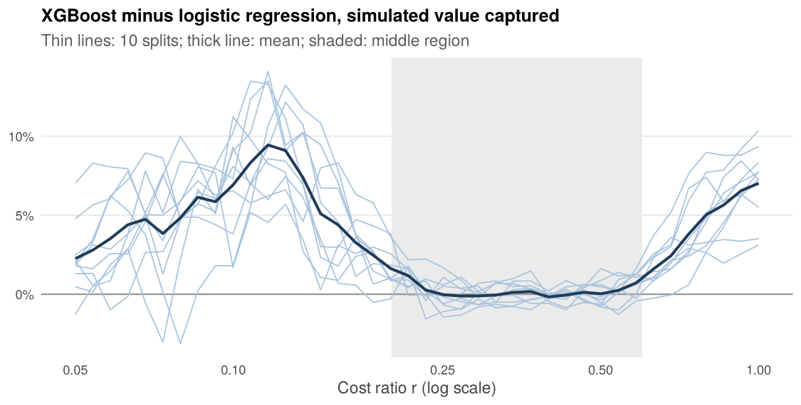

5. Robustness over splits
================

The results of parts 2 to 4 come from one split of the clients into
training and test sets. Here the whole procedure is repeated on 10 new
splits: a new stratified test set of 25%, new folds, the features, the
tuning of both models by cross-validation on the training part (20
boosting configurations instead of 30, to keep the run time reasonable),
the final fit and the evaluation on the test part. The numbers come from
`scripts/run_splits.R`.

The test sets of different splits overlap, so the 10 results are not
independent and their spread understates the uncertainty. Intervals on
this page use the corrected resampled $t$ statistic of Nadeau and Bengio
(2003), which inflates the variance of the mean difference $\bar d$ over
$J$ splits to

$$
\left( \frac{1}{J} + \frac{n_{\text{test}}}{n_{\text{train}}} \right) s_d^2 ,
$$

where $s_d^2$ is the sample variance of the differences across splits.

## Predictive performance

| model                | test log loss, mean (min to max) | test AUC, mean (min to max) |
|:---------------------|---------------------------------:|----------------------------:|
| Constant             |        0.5284 (0.5284 to 0.5284) |      0.500 (0.500 to 0.500) |
| Rule PAY_1 \>= 2     |        0.4669 (0.4633 to 0.4715) |      0.643 (0.637 to 0.650) |
| Logistic, raw        |        0.4520 (0.4495 to 0.4560) |      0.755 (0.748 to 0.762) |
| Logistic, engineered |        0.4355 (0.4320 to 0.4391) |      0.778 (0.767 to 0.784) |
| XGBoost, raw         |        0.4265 (0.4212 to 0.4292) |      0.785 (0.778 to 0.791) |
| XGBoost, engineered  |        0.4245 (0.4184 to 0.4281) |      0.788 (0.778 to 0.796) |

| comparison                                  | mean difference in log loss |         95% interval | splits where the first is better |
|:--------------------------------------------|----------------------------:|---------------------:|---------------------------------:|
| Logistic, engineered vs Logistic, raw       |                     -0.0165 | \[-0.0196, -0.0134\] |                         10 of 10 |
| XGBoost, engineered vs XGBoost, raw         |                     -0.0020 | \[-0.0038, -0.0003\] |                          9 of 10 |
| XGBoost, engineered vs Logistic, engineered |                     -0.0110 | \[-0.0135, -0.0084\] |                         10 of 10 |
| Logistic, engineered vs Rule PAY_1 \>= 2    |                     -0.0314 | \[-0.0354, -0.0275\] |                         10 of 10 |

The conclusions of parts 2 and 3 hold across splits, and every interval
in the table excludes zero. The engineered features improve the logistic
regression by about 0.017 in log loss and boosting by about 0.002, and
boosting beats the logistic regression on the engineered features by
about 0.011. The boosting gain from the engineered features is the
smallest effect on the page and the only one that reverses on a split (1
of 10).

## Simulated value

Part 4 found that XGBoost is worth more than the logistic regression
when acting is cheap ($r < 0.15$) and slightly less in the middle of the
range ($0.2 < r < 0.6$), with regions drawn after looking at the test
set. The same regions, now fixed in advance, give on the new splits:

| region          | XGBoost minus logistic, mean | 95% interval   | splits where XGBoost is ahead |
|-----------------|------------------------------|----------------|-------------------------------|
| $r < 0.15$      | +5.6 points                  | \[+3.9, +7.4\] | 10 of 10                      |
| $0.2 < r < 0.6$ | +0.2 points                  | \[-0.5, +0.8\] | 6 of 10                       |

<!-- -->

The advantage of XGBoost at low cost ratios is confirmed: it holds on
average across splits with an interval that excludes zero. In the middle
range the lead of the logistic regression found in part 4 does not
survive: no statistically detectable difference in simulated value was
found between the two models in this region. This is not a proof of
equivalence, which would need a margin fixed in advance, but the
interval rules out differences larger than about 0.8 points. Part 4 was
a single test set, and this is the kind of result that a second look is
for.

## What this changes

The ranking by predictive quality is stable: engineered features over
raw ones, boosting over the logistic regression, and both far ahead of
the rule. The economic comparison is more fragile, which is expected,
since it depends only on the clients near one threshold rather than on
all of them. The conclusion that survives is the one stated as a
business choice in part 4: at low cost ratios boosting is the better
candidate, and in the middle of the range no difference in simulated
value between the two models could be detected.

## Scope of this check

The ten splits reuse the same 30,000 clients, including those of the
original test set, and the two cost regions were defined after the
analysis of part 4. This is a check of how stable the results are to the
choice of split, not a validation on new data. That would require
clients from another period or another bank, which this data set does
not contain.
