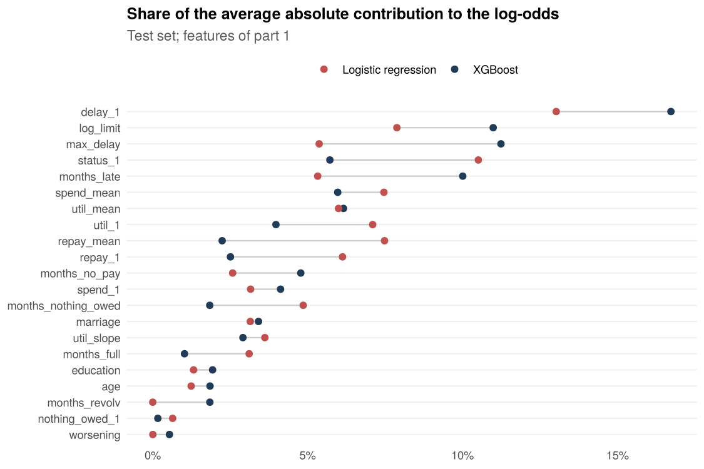
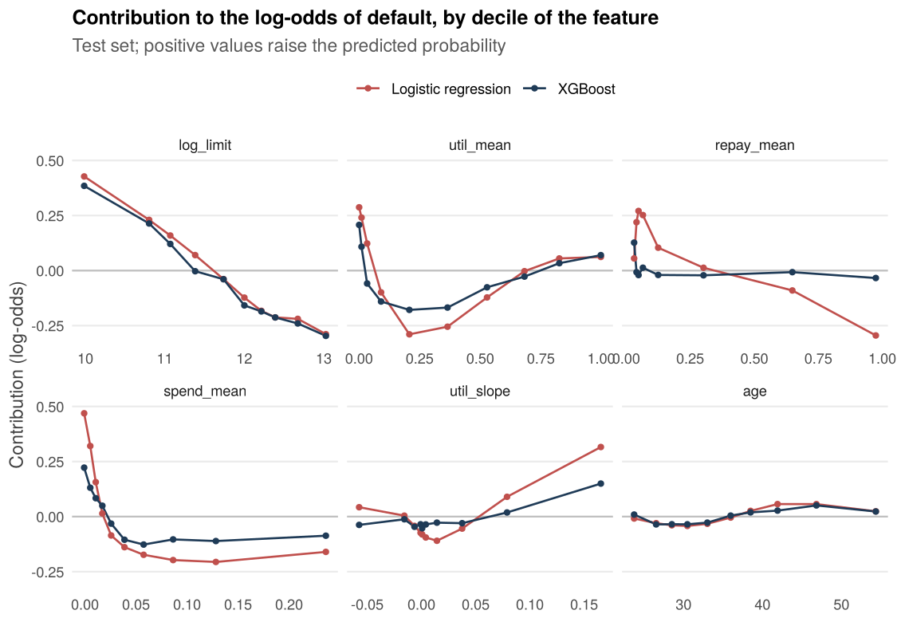

6. What the models learned, and who they flag
================

Both models are read on the test clients. For the logistic regression,
the contribution of a feature is its term in the log-odds. For XGBoost
it is its SHAP value (Lundberg and Lee, 2017), which splits each
prediction, on the log-odds scale, into a sum of contributions of the
features. Both are on the log-odds scale, but they do not share out the
credit in the same way: for an additive model the centred term is
exactly the SHAP value, while for boosted trees the credit given to
correlated features depends on how the trees use them. The comparisons
below are therefore qualitative, about which features matter and in
which direction, not an exact match of importances. Neither method says
anything causal: they describe what the models use, not what makes a
client default.

## Which features matter

<!-- -->

The two models agree on what comes first. The delinquency history
(`delay_1`, `max_delay`, `months_late`, `status_1`, `months_no_pay`,
`worsening`) accounts for 49% of XGBoost’s contributions. The credit
limit comes next: the bank’s own past assessment of the client is one of
the strongest signals available. Beyond these, the logistic regression
spreads more weight over the repayment ratios and utilisation, which
carry part of the same information as the delinquency features, while
XGBoost leans more on the delay counts. The lasso kept 49 of the 53
columns of the logistic regression, so the penalty mostly shrinks rather
than selects.

## The shape of each effect

For the continuous features the logistic regression fits a spline, so
its effects are curves too. The figure compares, for six features, the
average contribution in each decile of the feature, for both models.

<!-- -->

What the curves say:

- **Credit limit.** The higher the limit, the lower the risk, steadily
  over the whole range. Part of this is the bank’s earlier assessment of
  the client, which the model inherits.
- **Utilisation.** A U shape. Accounts that are barely used are riskier
  than those at around 20% of their limit, in line with the higher
  default rate of clients with nothing owed found in part 1. Above that,
  risk rises with utilisation: clients close to their limit have little
  room left.
- **Repayment ratio.** Both models put most of the effect at the low
  end: repaying only a few percent of the statement is the signal.
  Beyond that the logistic regression keeps rewarding higher repayment
  while XGBoost is flat, presumably because its delinquency features
  already carry that information.
- **New charges.** Clients who keep adding to their balance are safer,
  as found in part 1, where the reading as a consequence of delinquency
  rather than a cause was discussed.
- **Utilisation trend.** A balance that grows relative to the limit over
  the six months raises the risk.
- **Age.** A small effect: clients in their thirties get the lowest
  risk, and older clients a slightly higher one.

The two models draw broadly the same shapes. XGBoost’s advantage in log
loss therefore presumably comes less from different effects than from
interactions between features, which the additive logistic regression
cannot represent.

## Personal attributes

Education, marital status and age are inputs; sex is not. Their
contribution is small, and the models lose little without them. Both
models were refitted on account-level and credit-related features only,
excluding these three personal attributes, with the same
hyperparameters:

| model               |    out of fold, training set |                     test set |
|:--------------------|-----------------------------:|-----------------------------:|
| Logistic regression | +0.0008 \[+0.0002, +0.0015\] | +0.0014 \[+0.0002, +0.0024\] |
| XGBoost             | +0.0015 \[+0.0007, +0.0023\] | +0.0009 \[-0.0006, +0.0023\] |

Change in log loss when education, marital status and age are removed,
with 95% paired bootstrap intervals

The loss is about a thousandth of log loss, a tenth of the gap between
the two models. There is also a reason beyond accuracy to drop them.
Under the US Equal Credit Opportunity Act, for example, marital status
is a prohibited basis for a credit decision, and age may enter a scoring
system only if elderly applicants are not assigned a negative value.
Here older clients receive a slightly higher risk than those in their
thirties, which would have to be checked against such a rule. This is
one jurisdiction among others, and the rules that applied to this
Taiwanese bank are not assessed here. In general, a model restricted to
account-level and credit-related features is easier to defend, and on
this data it costs almost nothing. It is not free of history either: the
credit limit is itself an earlier decision of the bank.

## Decisions by sex

Sex is not an input, but other features can act as proxies for it. The
check is on the decisions themselves, at the middle cost ratio
$r = 0.25$ (threshold 20%), for the main model and for the model without
personal attributes.

| model                           | group | clients | default rate | mean prediction | acted on | good clients acted on | defaulters caught |
|:--------------------------------|:------|--------:|-------------:|----------------:|---------:|----------------------:|------------------:|
| XGBoost                         | men   |   2,949 |        24.6% |           23.0% |    37.3% |                 27.7% |             67.0% |
| XGBoost                         | women |   4,551 |        20.5% |           21.1% |    32.2% |                 23.3% |             66.8% |
| XGBoost, no personal attributes | men   |   2,949 |        24.6% |           23.0% |    37.2% |                 27.6% |             66.5% |
| XGBoost, no personal attributes | women |   4,551 |        20.5% |           21.0% |    32.0% |                 23.1% |             66.5% |

The models catch the same share of defaulters among men and women (67%
and 67%). Men who would have repaid are acted on more often than women
who would have repaid: the gap is 4.4 points (95% interval \[1.9, 6.6\])
for the main model and 4.5 points (\[2.2, 6.9\]) without the personal
attributes, so removing them does not close it.

| group |              intercept |               slope |
|:------|-----------------------:|--------------------:|
| men   | +0.11 \[+0.02, +0.21\] | 0.93 \[0.85, 1.02\] |
| women | -0.05 \[-0.13, +0.04\] | 1.01 \[0.94, 1.09\] |

Calibration intercept and slope of XGBoost within each group, test set,
with 95% bootstrap intervals

Within each group the calibration can be checked as in part 3. An
intercept above zero means the model predicts too little default for
that group. The model is not calibrated for men: their intercept is
above zero with an interval that excludes it, so the model slightly
underestimates their risk. It is calibrated for women. The extra false
alarms for men therefore do not come from the model overstating their
risk; they come from the larger share of men whose histories look risky,
defaulters or not.

Men in this portfolio default more often (24.6% against 20.5%), and
their account histories differ. The observed disparity may reflect
differences in base rates and account histories, but it does not by
itself establish that the model is fair or that the gap is unavoidable.
What the literature does establish is a constraint: when base rates
differ, a score that is calibrated within each group cannot also give
equal false positive rates and equal true positive rates (Chouldechova,
2017; Kleinberg, Mullainathan and Raghavan, 2016). A bank has to decide
which of these properties to protect, and a gap such as this one is a
reason to investigate which features drive it, not a result to accept as
it stands. Group-specific thresholds would equalise false alarms, but
they would make the decision depend on sex explicitly, which is itself
prohibited in many jurisdictions.

## Limits

- SHAP values and spline terms describe the model, not the clients. A
  large contribution of the credit limit does not mean that raising a
  limit lowers risk.
- The fairness check covers sex only. Age bands and other groups could
  be checked the same way.
- Contributions are averaged over the test set and say little about any
  single client. Explaining an individual decision, as a declined
  applicant may be entitled to, would use the client’s own
  contributions.
